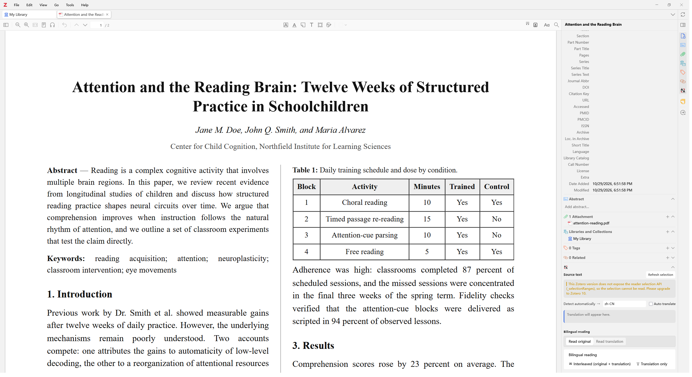
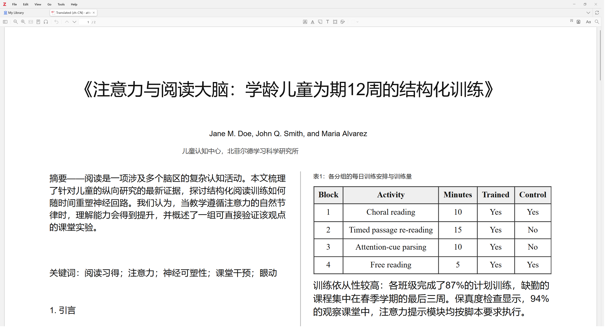
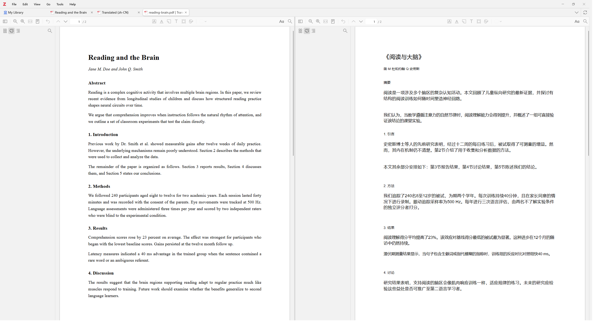
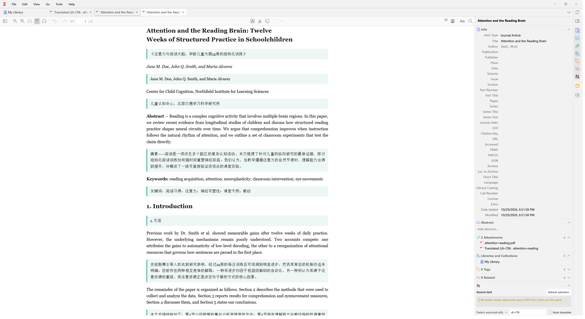
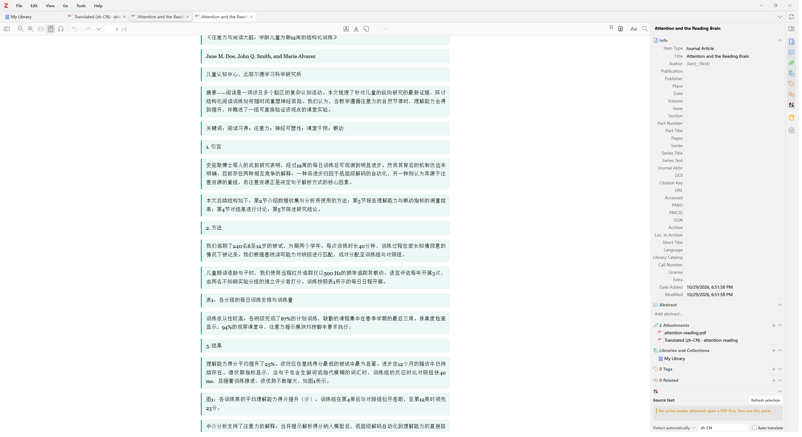
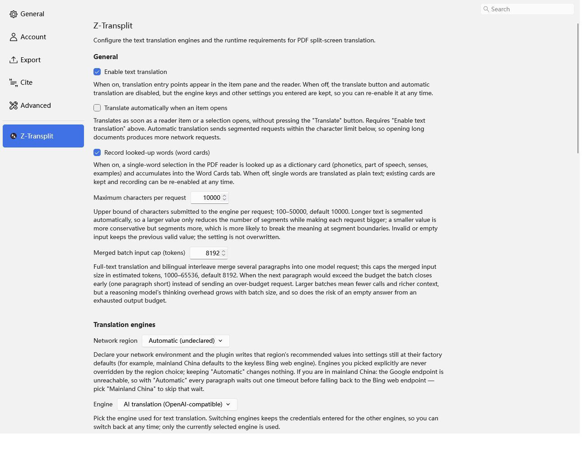

<h1>
  <picture>
    <source media="(prefers-color-scheme: dark)" srcset="addon/content/icons/ztransplit-dark.svg" />
    
  </picture>
  Z-Transplit
</h1>

**English** | [中文](README.zh-CN.md)

**Selection Translation · Layout-preserving PDF Translation · Split-screen · Bilingual Interleave · Translation-only · Read-aloud — an all-in-one Zotero translation plugin.**

Z-Transplit is a standalone plugin for Zotero 10 that puts the whole translation toolkit
for reading foreign-language literature in one place: instant translation of the reader's
selection, layout-preserving full-text PDF translation that produces a translated
attachment, side-by-side split reading in one tab, Zotero 10 reading-mode bilingual
interleave with a translation-only mode, plus a cross-session translation cache and
sentence-level read-aloud.

All UI is built with Zotero's native XUL/HTML. No React, no iframe bridge.

## Installation

1. Download the latest `z-transplit.xpi` from [Releases](../../releases);
2. In Zotero: Tools ▸ Add-ons ▸ gear menu ▸ Install Add-on From File, and pick the
   downloaded xpi;
3. Open a PDF — the "Translate" section and the context-menu entries appear.

> The slim installer (the default download) does not bundle the ~24 MB layout-parsing
> component or the ~43 MB Java runtime: on first use they are downloaded automatically
> by racing several mirrors concurrently, and the bytes must pass the official SHA-256
> checksum before anything is installed — no administrator rights needed. For offline
> environments, grab the `*-full.xpi` from the release page instead.

## Features

### 1. Selection Translation

Select any text in the reader and the "Translate" section shows source and translation
with one-click copy. Automatic source-language detection, a target-language box (Enter
or blur commits it; Enter during IME composition only confirms the candidate), and
read-aloud of the result. A failed translation, an empty result, an over-long selection
and an unconfigured engine each get their own explicit message — never a silent blank.

- A "Refresh selection" button re-reads the current reader selection
- The target-language box commits on Enter or blur; Enter while composing an IME
  candidate does not submit
- The result area has four states: translating (a shimmer skeleton), failed (reason +
  retry), success (translation + copy), idle (a "Translate" button when auto-translate
  is off)
- A copy failure keeps the translation on screen and appends a transient failure note
  instead of discarding it
- With "auto-translate" on, a selection starts translating immediately

### 2. Full-text Translation (translated attachment)

Right-click a PDF (in the library or the reader) → "Translate full text (save as
attachment)". OpenDataLoader (local JVM) parses the layout, paragraphs are translated,
and the result is re-rendered preserving the original layout, stored as a
"Translated (zh-CN)" attachment and opened automatically. Repeat runs are deduplicated: an
existing translation is opened instead of re-running the pipeline.

- Layout-preserving: columns, tables and image positions are mapped back, and mixed
  CJK/Latin paragraphs are drawn run-by-run with the matching font
- CJK fonts are resolved automatically — Microsoft YaHei / PingFang / Noto per target
  language — with an explicit notice when none is found instead of tofu glyphs; drop a
  `translated-regular.ttf` into `{data dir}/ztransplit/translation-assets/` to override
  (e.g. Noto Serif SC to match the serif look of most papers)
- Formulas (`$…$` / `{v0}`) are swapped for placeholders before translation and painted
  back in position; the default template asks the model to keep them verbatim
- A multi-PDF selection runs the pipeline serially, with ordinal labels in the
  progress window and one failure never stopping the rest

### 3. Split-screen Reading

Right-click (reader or library) → "Translate and open side by side" / "Split-screen
comparison": one tab, two readers side by side, with a 5px drag resizer between them
and bidirectional scroll, page and zoom sync — for close paragraph-by-paragraph reading.

- "Split-screen comparison" needs no translation: the current PDF and another PDF
  under the same parent item, side by side
- "Translate and open side by side" runs the full-text pipeline when no translation
  exists yet, and reuses an existing one when it does
- While a translation runs, the context menu gains "Cancel translation in progress"

### 4. Interleaved Bilingual Reading (Zotero 10)

Turn on "Bilingual reading" in the reader's Translate section: Zotero 10's SDT reading mode
reflows the PDF into structured text and injects a translation block under every
paragraph, translated lazily as you scroll, with live `3/12 paragraphs translated`
progress. The "Interleaved" and "Translation only" buttons also work before a
session starts — one click starts the session straight in that mode, and the
choice is remembered for the next session. A paragraph that was never
translated automatically (a late-rendered block, a list or table) needs no
mode switch either: select it and click the "Translate this paragraph" pill
to translate it on the spot — or to retranslate an existing translation.

### 5. Translation-only Mode

In the same bilingual session switch to "Translation only": original blocks are hidden,
leaving only the translation for smooth reading. Click a translated paragraph to
temporarily reveal its original text (click it again, or click another paragraph, to
hide it) — no mode switching needed when a translation is hard to understand.

> Interleaved and translation-only modes are built on Zotero 10's reading mode;
> every other feature (selection, full-text, split, read-aloud) works everywhere
> in the supported range.

### 6. Read-aloud

Both the bilingual session and the Translate section support read-aloud (Windows SAPI /
system TTS) with sentence-level highlight tracking: the original is located via the PDF
text layer, the translation via the bilingual blocks. Pause/resume, previous/next
sentence and stop are all there.

## Translation Engines

Switchable in the settings pane (Edit ▸ Settings ▸ Z-Transplit). All share a
content-addressed cross-session cache: the same text + language pair + engine answers
from cache on the second request, and editing one character re-translates. The cache
is shared across all four entry points — full-text translation, split view, the
bilingual view and selection translation — so a paragraph translated anywhere is
reused verbatim by every other entry point.

| Engine | API key | Notes |
| --- | --- | --- |
| Google | optional | Free endpoint, automatic Bing-web fallback |
| Bing | required | Azure Translator REST API |
| DeepL | required | free / pro endpoint toggle |
| AI | endpoint required, key optional | OpenAI-compatible chat/completions with a user-owned prompt template |
| Custom | required | OpenAI-compatible chat/completions |
| zotero-pdf-translate | — | Delegates to the plugin when detected |

### Configuring the AI engine

With the "AI" engine selected, the settings pane gains a "Provider" dropdown at the
top of the engine section. Picking DeepSeek, Qwen, Zhipu GLM, Kimi, StepFun, OpenAI,
Ollama or LM Studio fills in the endpoint and a recommended model name automatically,
usually leaving only the API key to paste — local providers (Ollama, LM Studio) need
no key at all. "Custom" remains for self-hosted gateways and vLLM. When you are not
sure what to fill in, start by picking a provider here. Then press "Test connection":
the plugin sends one minimal request with the values currently in the form and turns
the outcome into something actionable — key rejected, endpoint not found, unreachable,
rate limited — so a misconfiguration no longer has to be discovered by running a
translation first. A model name you edited by hand is never overwritten by a preset.

### The AI engine's prompt template

The AI engine hands "what gets sent to the model" to the user, and keeps two things for
itself: the language configuration and the template validation.

- A template must contain three placeholders — `{{text}}` (the text to translate),
  `{{sourceLang}}` and `{{targetLang}}`. They use double braces on purpose: `{v0}` /
  `{v1}` single-brace markers are formula positions in the pipeline, and the default
  template asks the model to keep them verbatim.
- The plugin resolves the language codes to readable names (`zh-CN` → Simplified
  Chinese) instead of sending raw codes.
- The template is validated as you type in the settings pane: misspelled, missing,
  duplicated or unbalanced placeholders and over-long templates each get their own
  inline message, an invalid value is never written to the settings, and a stored
  invalid template is blocked by the readiness check, which points back at the pane.
  An empty field restores the built-in default template.
- The cache invalidates by template fingerprint — editing one character forces a
  re-translation instead of serving results from the old prompt.
- Requests go out per paragraph (no batch JSON), same as any other model backend
  (self-hosted Ollama, vLLM, a gateway, …).

## Entry Points

- The reader's / item's "Translate" section: selection translation, bilingual,
  translation-only, read-aloud
- Reader right-click (PDF view): "Translate and open side by side", "Split-screen
  comparison", "Cancel translation in progress"
- Library right-click: "Translate full text (save as attachment)" and "Translate and
  compare side by side" — visible only when the selection contains a PDF
- Edit ▸ Settings ▸ Z-Transplit: engine, credentials, target language, Java and
  OpenDataLoader options

## Development

Architecture notes, the porting history, and the build / quality-gate / release
workflows live in [docs/development.md](docs/development.md).

## License

Copyright (C) 2026 z-transplit contributors

AGPL-3.0 — see [LICENSE](LICENSE). Same license as Zotero itself.
